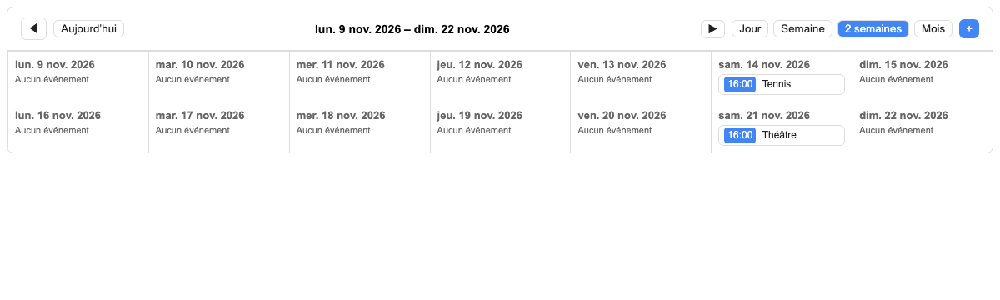
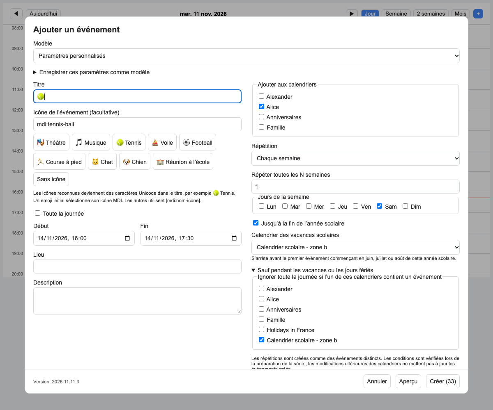

# Outlook Calendar Card for Home Assistant

[English](README.en.md) · [Français](README.fr.md) · [Русский](README.ru.md)

A calendar card with day, week, two-week and month views, event creation and editing, and automatic English, French and Russian localization.



- Show all Home Assistant calendars or choose a list.
- Use calendar colors and icons, with optional overrides.
- Create events in multiple calendars, including daily and weekly schedules.
- Skip school holidays and public holidays using exclusion calendars.
- Save activity templates and select event icons such as 🎾, 🎭 and 🎵.
- Edit existing events when their integration supports updates.

## Installation

<!-- ha-marketplace:exclude-start -->
[](https://my.home-assistant.io/redirect/marketplace_repository/?owner=dmitry-pervushin&repository=ha-calendar-card&category=plugin)

Add `https://github.com/dmitry-pervushin/ha-calendar-card` as a custom repository in Home Assistant Marketplace, with type **Dashboard** (`plugin`). In older HACS versions, use **Custom repositories → Dashboard**. Install the card, then reload the browser.

The repository must be public before Marketplace/HACS can install it. Preparing the repository does not automatically add it to the shared catalog.

For YAML-managed dashboard resources, add this module if the installer did not add it automatically:

```yaml
url: /local/community/ha-calendar-card/outlook-calendar-card.js
type: module
```

If migrating from a manual installation, remove the old `/local/outlook-calendar-card.js` resource entry so only one copy is loaded. Manual installation remains available; see the documentation in your language.
<!-- ha-marketplace:exclude-end -->

## Configuration

```yaml
type: custom:outlook-calendar-card
view: two-weeks
start_hour: 0
end_hour: 24
```

Omit `calendars` to show all calendars. To select calendars explicitly:

```yaml
type: custom:outlook-calendar-card
calendars:
  - entity: calendar.work
  - entity: calendar.family
view: two-weeks
```

## Event dialog



Recurring schedules are created as individual events. Exclusion calendars are checked when preparing the schedule; later holiday changes do not modify already-created events. Editing depends on the calendar integration’s update support.

See the full guides for [English](README.en.md), [French](README.fr.md) or [Russian](README.ru.md) instructions, configuration details and limitations.

## Development and releases

```sh
npm ci
npm run check
npm test
```

GitHub Actions runs the JavaScript checks and the HACS validator with category `plugin`. Publishing a GitHub release runs the checks again for the tagged source and attaches `outlook-calendar-card.js` to that release. Use the value of `CARD_VERSION` as the release tag.

The card is a standalone JavaScript module with its translations included. `hacs.json` identifies its existing filename in the repository root; no build step or filename migration is required.

## License

Released under the [MIT License](LICENSE).
